# Academia Hub — College Admission Management System

A PHP and MySQL web application for college admissions. The project includes a public college website, student account and application pages, and an admin portal for managing courses, reviewing applications, and handling fees.

## Features

- Public home, departments, courses, about, and contact pages
- Student registration, login, dashboard, and profile
- Online admission application and fee submission pages
- Admin dashboard, registered user list, course management, and application review
- MySQL schema in `database/schema.sql`

## Technology

- PHP and MySQL/MariaDB
- HTML, CSS, JavaScript, Bootstrap, and bundled frontend assets
- XAMPP for local development

## Local setup

1. Clone the repository into your web server document root (for XAMPP, `htdocs`).
2. Create a MySQL database named `camsdb` in phpMyAdmin.
3. Import `database/schema.sql` to create the tables.
4. Check the database settings in `cams/includes/dbconnection.php`, `cams/admin/includes/dbconnection.php`, and `cams/user/includes/dbconnection.php`.
5. Start Apache and MySQL, then open `http://localhost/Academiahub/cams2/cams/` (or the matching path for your install).
6. Admin pages are under `/cams/admin/`; student pages are under `/cams/user/`.

Create your own local admin and student accounts. This repository does not include sample login credentials.

## Screenshots

The screenshots below show the project running locally with fictional demo records.

### Public site

#### Home page

#### Departments

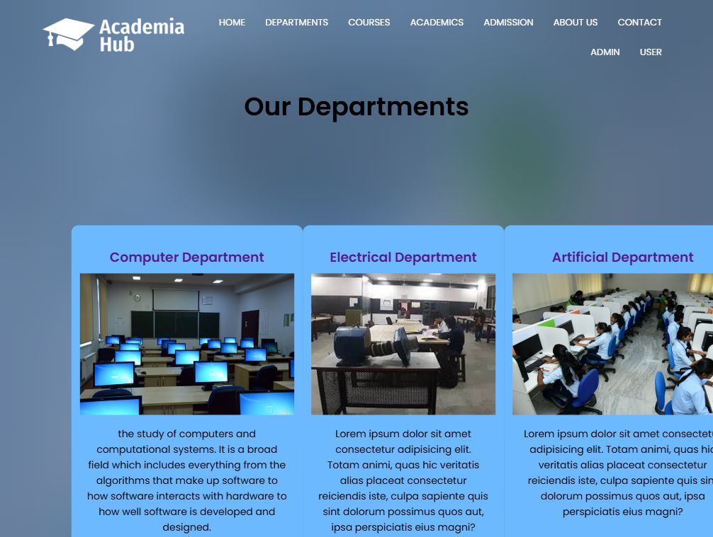

#### Course catalog

#### About

#### Contact

### Student portal

#### Student login

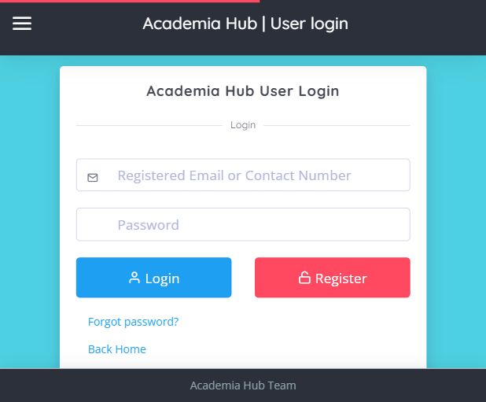

#### Student registration

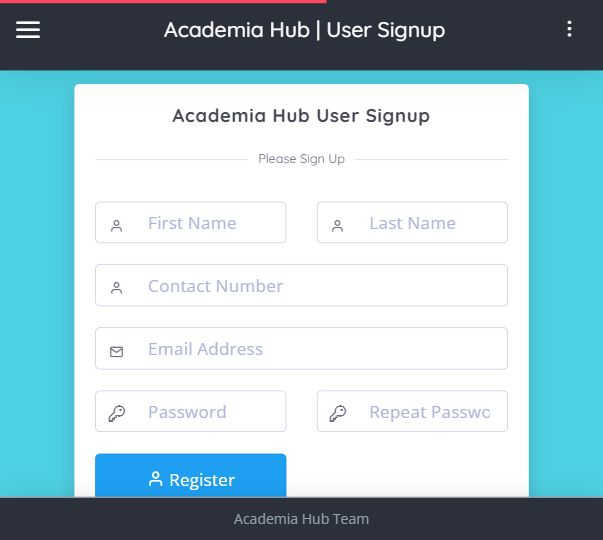

#### Student dashboard

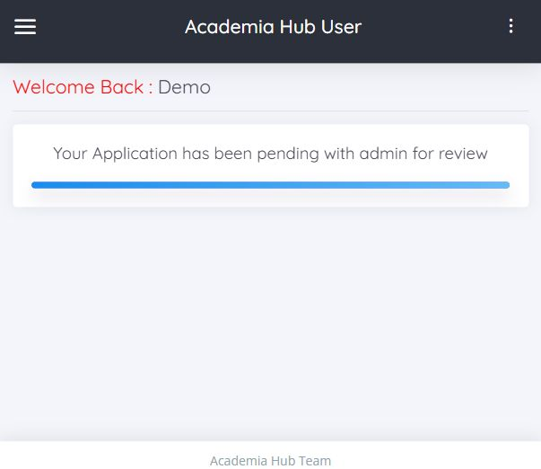

#### Admission application form

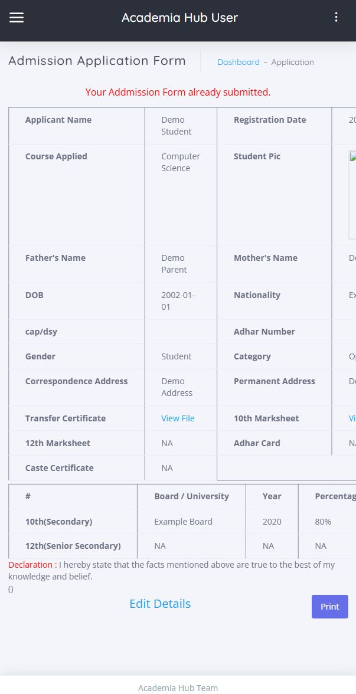

#### Fee submission

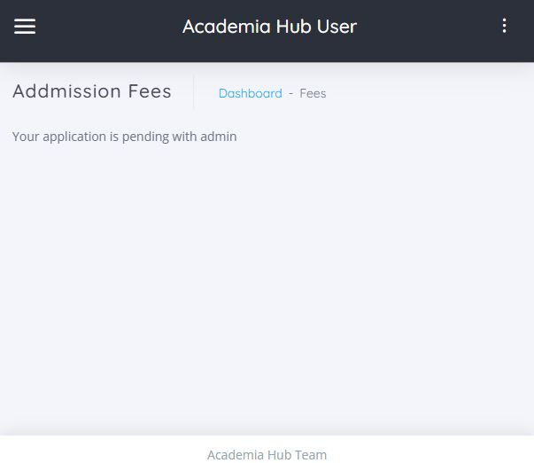

#### Student profile

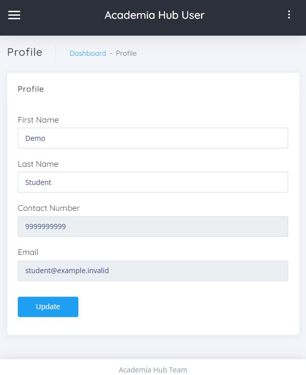

### Admin portal

#### Admin login

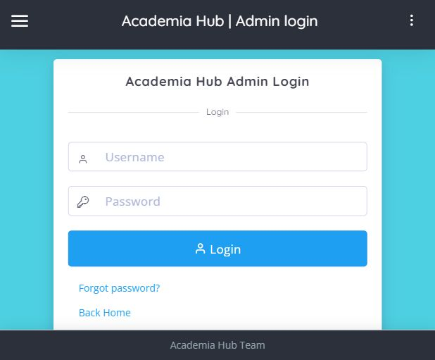

#### Admin dashboard

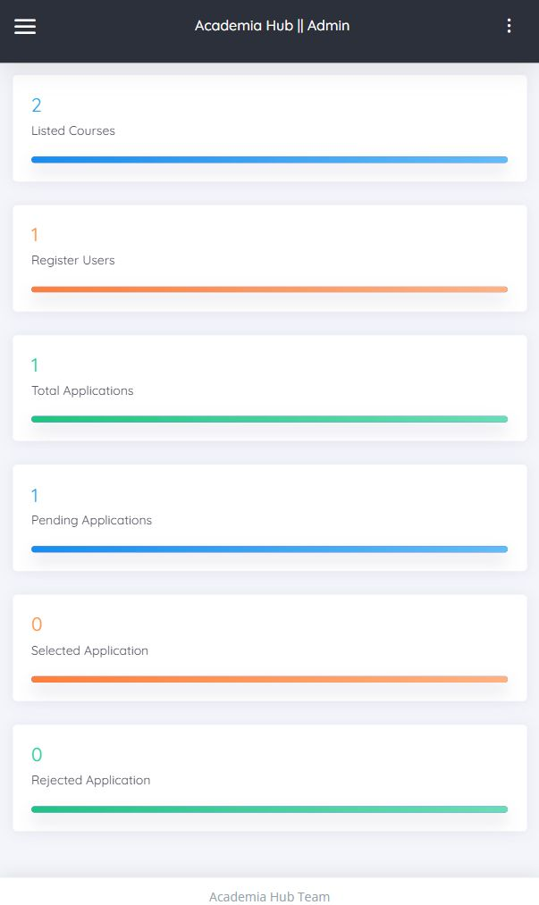

#### Applications

#### Application review

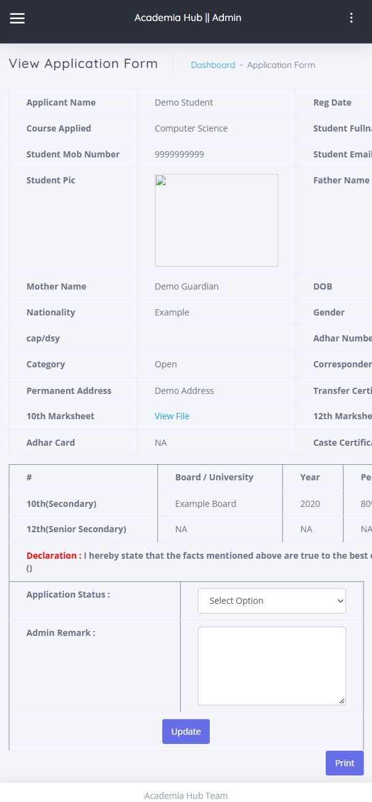

#### Pending applications

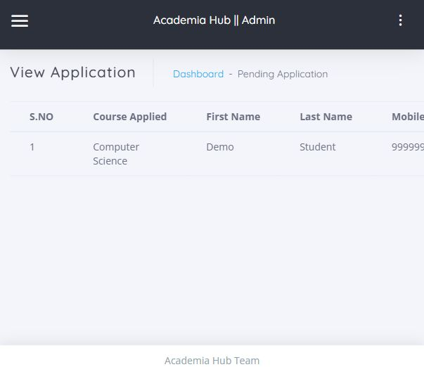

#### Course management

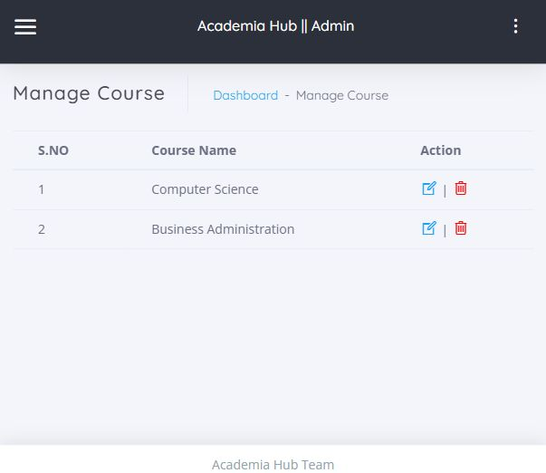

#### Registered users

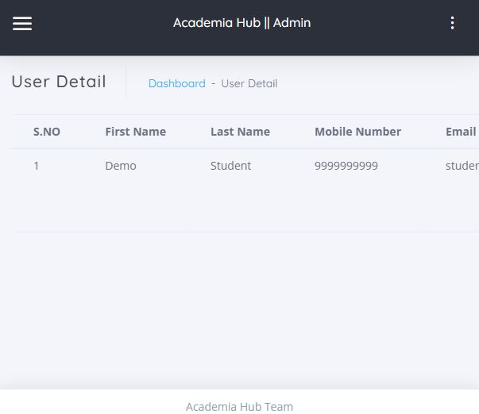

#### Reports

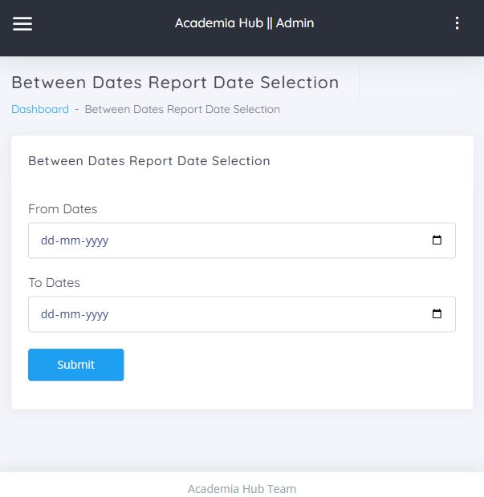

## Privacy

Database dumps with personal records and password hashes, and student-uploaded documents, are excluded from this repository. The screenshot data is fictional. Use fictional records for local development and do not commit private applicant documents or credentials.
