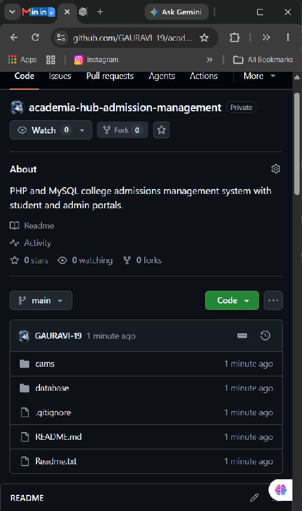

# Academia Hub — College Admission Management System

A PHP and MySQL web application for college admissions. It includes a public college information site, student registration and application pages, and an administration area for reviewing applications, managing courses, and handling fees.

## Features

- Public pages for courses, departments, notices, and contact enquiries
- Student registration, login, profile, and admission application workflows
- Admin dashboard and application review tools
- Course, notice, and fee management
- MySQL database schema in `database/schema.sql`

## Requirements

- XAMPP (Apache, PHP, and MariaDB/MySQL) or an equivalent local PHP/MySQL stack
- PHP `mysqli` extension enabled

## Local setup

1. Clone this repository into your web server's document root (for XAMPP, `htdocs`).
2. Create a MySQL database named `camsdb` in phpMyAdmin.
3. Import `database/schema.sql` to create the tables.
4. Review the database settings in `cams/includes/dbconnection.php`, `cams/admin/includes/dbconnection.php`, and `cams/user/includes/dbconnection.php` for your local MySQL account.
5. Start Apache and MySQL, then open `http://localhost/cams/`.
6. Open the admin area at `http://localhost/cams/admin/`.

Create your own administrator and student accounts for local development. Do not reuse credentials from sample project files.

## Project layout

- `cams/` — PHP application, assets, admin and student areas
- `database/schema.sql` — schema-only database setup (no applicant records or passwords)
- `screenshots/` — repository setup screenshot

## Screenshot

## Privacy

Database dumps containing personal records and password hashes, and student-uploaded documents, are intentionally excluded. Use fictional data for local development and keep uploaded documents and credentials out of source control.
